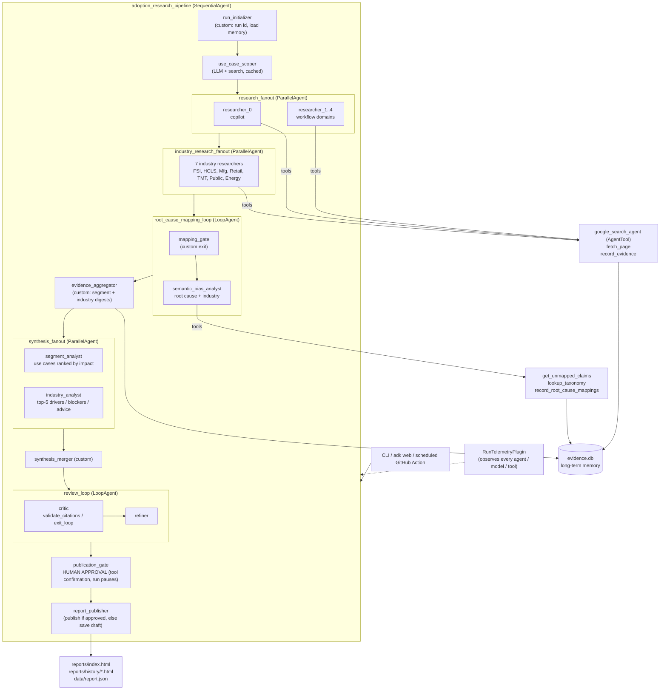

# Enterprise Agentic AI Adoption Research Agent

A multi-agent system built with the **Google Agent Development Kit (ADK)**. It searches the public web for reports on **what drives and what inhibits enterprise adoption of agentic AI** (Gemini, Microsoft Copilot, Claude and peers) and analyses them for **semantic bias**. It then publishes an **updatable HTML report** that improves with every run.

> **Live report:** https://johnenoch1966.github.io/John-Enoch/ · try the industry picker, e.g. [FSI](https://johnenoch1966.github.io/John-Enoch/#industry-fsi)
>
> Generated output (evidence database, reports, history) lives on the [`research-data`](https://github.com/johnenoch1966/John-Enoch/tree/research-data) branch, so `main` contains only code, tests and infrastructure.

---

## 1. Problem

Large enterprises are rolling out two very different kinds of agentic AI:

| Segment | Examples |
|---|---|
| **Copilot / desktop agentic assistants** | Gemini for Google Workspace, Microsoft 365 Copilot, Claude, ChatGPT Enterprise: email, meetings, documents, enterprise search |
| **Workflow-specific agents** | KYC/onboarding, insurance claims, support/service desk, complaints handling, contact centres, AML triage, invoice processing, coding agents, ... |

Adoption is uneven, and the public evidence about it is scattered across analyst reports, consultancy surveys, vendor case studies and regulators. That evidence is also **framed**. Reports often describe a *symptom* rather than the *root cause*:

> *"Access to connectors not enabled"* sounds like a technical gap. It is usually a **risk and auditability** gap: admins disable connectors because the organisation cannot audit or constrain what an agent reads and writes.

Leaders need a current, cited, bias-aware view of which factors really drive or block adoption, and which approaches lead to **high** versus **low** adoption.

## 2. Solution

The agent runs an end-to-end research cycle:

1. **Scope:** it identifies the **50 most commonly deployed enterprise agent use cases**, tags each one as copilot or workflow and with the industries it applies to, and groups them into 1 copilot cluster and 4 workflow clusters.
2. **Research (in parallel):** **5 use-case researchers** (one per cluster) and **7 industry researchers** (FSI, HCLS, Manufacturing, Retail & CPG, TMT, Public Sector, Energy & Utilities) search the web, read the primary sources and record **cited claims**. Each claim records the factor (driver or blocker), a quote, any statistic, the publisher, vendor affiliation, use cases and industry.
3. **Semantic-bias analysis:** an analyst agent maps every *stated* factor to an *underlying* root cause using an extensible [taxonomy](adoption_agent/taxonomy.yaml), notes framing bias from the source, and tags the industries the claim applies to.
4. **Synthesis (in parallel):** a **segment analyst** ranks every copilot and workflow use case by realised business impact. At the same time, an **industry analyst** builds each industry's top 5 drivers, top 5 blockers and 5 actions for success.
5. **Critique loop:** a reviewer validates every citation against the evidence store and checks coverage. A refiner fixes any problems, for up to 3 rounds.
6. **Human approval (human-in-the-loop):** before the public report is replaced, the run **pauses** and asks a person to approve a short summary. ADK tool confirmation drives this in `adk web`, and the CLI prompts in the terminal. If the person rejects it, only a draft is saved.
7. **Publish:** it renders a visual HTML report with these sections:
   - **Top AI use cases by industry**, each tagged Copilot or Workflow
   - **Copilot assistants ranked by impact**, showing impact score, adoption stage, main value, main blocker and evidence count
   - **Workflow agents ranked by impact**, in the same format
   - **Industry deep-dive**: pick an industry to see its top 5 drivers, top 5 blockers and 5 actions for success
   - **Semantic bias**: what reports say compared with what is really going on
   - **What changed** since the last run, with a full evidence appendix

Evidence **accumulates across runs** in a de-duplicated SQLite store, so each refresh makes the report broader and more robust.

## 3. Architecture



LLMs handle judgement (search strategy, extraction, root-cause reasoning, synthesis, critique). **Deterministic custom agents** handle bookkeeping: initialisation, loop gating, aggregation and publishing. This keeps runs cheaper, testable and predictable.

## 4. How the evaluation criteria are addressed

### Tool & Interface Design
- **Typed tools with Pydantic contracts** ([`schemas.py`](adoption_agent/schemas.py)). ADK generates the function schemas and validates the model's arguments before the tool runs.
- Tools **return structured, actionable results instead of raising**. For example, `save_use_case_catalog` returns a list of problems to fix, `record_root_cause_mappings` reports rejected ids with the valid options, and `fetch_page` reports HTTP errors.
- **Built-in Google Search isolated in its own agent and wrapped as an `AgentTool`**, so it can be combined with function tools. An `after_model_callback` adds the grounding source links to the search agent's reply, so researchers can read the real primary sources.
- `fetch_page` blocks non-public URLs, extracts readable HTML and PDF text, and truncates output to protect the context window.
- Interfaces: a **CLI** (`run`, `render`, `stats`), **`adk web`** (exports `app`), a container entrypoint and a JSON report contract.

### Context & Memory
- **Short-term memory:** session state passes data between stages (`use_case_catalog`, `evidence_digest`, `synthesis`, `critique`), with per-run `temp:` counters.
- **Long-term memory:** the SQLite evidence store, the cached use-case catalog and the previous report. Researchers are told which URLs are already known, the synthesizer receives a summary of the previous report, and the publisher diffs against it.
- **Context engineering:**
  - Every stage uses `include_contents="none"` plus dynamic instruction providers, so each agent sees only what it needs.
  - The evidence digest is **aggregated and capped** (at most 4 examples per segment × polarity × root-cause group), so prompt size stays bounded as evidence grows.
  - Fetched pages are truncated.

### Orchestration & Logic
- `SequentialAgent` → `ParallelAgent` (5 researchers) → `LoopAgent` (batch mapping with a deterministic exit gate) → synthesis → `LoopAgent` (critic/refiner with an LLM-driven `exit_loop`) → publisher.
- **Conditional execution** through `before_agent_callback`: the scoper is skipped when the catalog is cached, and synthesis is skipped when there is no evidence.
- Catalog validation enforces structural rules: about 50 use cases, exactly 1 copilot cluster plus 4 workflow clusters, no duplicates or orphans.
- **Human-in-the-loop stop** ([`hitl.py`](adoption_agent/hitl.py)): publishing replaces the *public* report, so it's gated by an ADK **tool confirmation** (`FunctionTool(require_confirmation=...)`) in a **resumable** app (`ResumabilityConfig`). The run pauses, a person approves or rejects the summary, and the same invocation resumes. Rejection keeps the public report unchanged and saves a draft, which `cli publish-draft` can promote after review.
  - The policy is set with `--approval prompt|auto|reject`. Unattended scheduled runs use `auto`, and the refresh workflow then opens a **pull request** that a person must merge before anything goes live.
  - The approval decision and summary are recorded in the report.
  - Tested end to end: approve, reject and publish-draft.

### Observability & Tracing
- [`RunTelemetryPlugin`](adoption_agent/observability.py) is an ADK plugin that observes **every** agent, model call and tool call:
  - structured JSON logs (ready for Cloud Logging)
  - per-agent latency and token usage
  - tool success and error counts
  - writes `runs/<run_id>/events.jsonl` and `metrics.json`
- **OpenTelemetry:** ADK's built-in spans are exported to a local SQLite trace store, to **Cloud Trace** (`ADOPTION_AGENT_TRACE_TO_CLOUD=true`) or to any OTLP collector. `adk web` shows the trace for each invocation.
- Tool exceptions are caught centrally and returned to the model so it can recover.

### Infrastructure & CI/CD
Full details are in **[`deployment/README.md`](deployment/README.md)**.

| Layer | Implementation |
|---|---|
| **Infrastructure as Code** | [`deployment/terraform/`](deployment/terraform) provisions APIs, least-privilege service accounts, **keyless Workload Identity Federation** for GitHub, Artifact Registry, a versioned GCS bucket for long-term memory, a **Cloud Run Job**, a weekly **Cloud Scheduler** trigger, and a **Monitoring alert** on failed runs. It supports separate `staging` and `prod` states, and is validated in CI with `terraform validate`. |
| **CI** | [`ci.yml`](.github/workflows/ci.yml) and [`.cloudbuild/pr_checks.yaml`](.cloudbuild/pr_checks.yaml) run ruff, a **bandit** security scan, a **pip-audit** dependency audit, a **gitleaks** secret scan, and pytest on 3.11 and 3.12 with an **80% coverage gate**. That includes an offline end-to-end test of the whole agent graph. CI also runs Terraform fmt/validate, and a Docker build with a container smoke test. |
| **CD** | [`cd.yml`](.github/workflows/cd.yml) and [`.cloudbuild/staging.yaml`](.cloudbuild/staging.yaml) build the image once and push an immutable digest. They deploy to **staging** and verify the rollout. After **manual approval**, the same digest is promoted to **production** ([`deploy-to-prod.yaml`](.cloudbuild/deploy-to-prod.yaml)). |
| **Infrastructure pipeline** | [`infra.yml`](.github/workflows/infra.yml) runs `terraform plan` on PRs and `apply` after approval. |
| **Operations** | Scheduled refreshes, GCS state sync so Cloud Run Jobs keep memory between runs, rollback by digest, `--resume` recovery, and an alert policy. [`pages.yml`](.github/workflows/pages.yml) publishes the report. |
| **Supply chain** | `requirements.lock` (pinned with uv), a multi-stage non-root Dockerfile, [Dependabot](.github/dependabot.yml) for pip, Actions, Docker and Terraform, and [pre-commit](.pre-commit-config.yaml) hooks. |
| **Developer experience** | A [`Makefile`](Makefile) covering `make check`, `test`, `playground`, `docker-build`, `tf-plan`, `deploy-job`, `run-job` and `deploy-agent-engine`. |

### Privacy: PII masking
Personal data is masked at **every boundary** where third-party content enters or leaves the system ([`privacy.py`](adoption_agent/privacy.py), [`guardrails.py`](adoption_agent/guardrails.py)):

| Boundary | Control |
|---|---|
| Web content → model | `fetch_page` masks PII before returning page text |
| Any agent → model | **`PiiRedactionPlugin`** (an ADK plugin) masks every text and function-response part of **every model request**, for all agents including nested search agents |
| Any tool → model | the same plugin masks every **tool result** |
| Model → storage | `record_evidence` masks claims and source fields before persisting |
| Existing data | an idempotent back-fill re-masks the evidence store at the start of each run |
| Logs | telemetry masks tool arguments and results before logging |

- **Detected types:** email, phone (international and US), payment card (with a Luhn check), IBAN, US SSN, UK National Insurance number, IPv4 address, and credentials in URLs. Each value is replaced with a typed placeholder such as `[REDACTED_EMAIL]`.
- **False-positive guards** keep research statistics intact: percentages, years, prices and version numbers.
- **Cloud DLP backend** (`ADOPTION_AGENT_PII_BACKEND=dlp`, enabled in the Terraform deployment) adds PERSON_NAME, street address and date of birth. If DLP is unavailable it falls back to regex, so masking **never fails open**.
- **Auditable:** every run writes `runs/<run_id>/privacy.json` with counts by type and agent, and the report shows the total masked.
- **Tested:** [`tests/test_privacy.py`](tests/test_privacy.py) has 23 tests covering detection, false positives, idempotency, the DLP fallback and each enforcement point.

## 5. Quick start

```bash
git clone https://github.com/johnenoch1966/John-Enoch.git && cd John-Enoch
python3 -m venv .venv && source .venv/bin/activate
pip install -e ".[dev]"

# Model access through Vertex AI + Application Default Credentials
gcloud auth application-default login
cp .env.example .env    # set GOOGLE_CLOUD_PROJECT

# Run a research cycle (about 10-20 min)
python -m adoption_agent.cli run                  # uses the cached use-case catalog if present
python -m adoption_agent.cli run --refresh-scope  # rebuild the top-50 list
open reports/index.html   # you are asked to approve publication first; `make publish-data` pushes it live

# Or explore interactively, with traces, in the ADK dev UI
adk web .        # choose "adoption_agent", send "run"
```

Other commands: `python -m adoption_agent.cli stats` shows the evidence-base size, and `python -m adoption_agent.cli render` re-renders the HTML.

**Resilience:** all model calls retry rate-limit (429) and server (5xx) errors with increasing waits and random jitter. Every source and claim is saved the moment it is recorded, so an interrupted run loses no research. `python -m adoption_agent.cli run --resume` skips the web research and continues from root-cause mapping using the stored evidence. `--research clusters|industries|none` runs only one of the two research fan-outs.

**Schema migrations:** when the evidence store gains new fields, such as industry tags, existing data is migrated in place. Older claims are automatically re-tagged on the next run.

## 6. Tests

```bash
pytest -v
```

| Test | Covers |
|---|---|
| `test_store.py` | URL normalisation, de-duplication, mapping state, bounded digests, industry tagging, **migration of older databases** |
| `test_tools.py` | taxonomy lookup (including the *connectors → risk & auditability* case), evidence/mapping validation, citation checks, catalog rules, industry normalisation |
| `test_web.py` | HTML extraction, truncation, HTTP errors, blocking of non-public URLs (mocked HTTP) |
| `test_report.py` | citation sanitising, impact ranking, industry views, run-to-run diff, HTML rendering, XSS escaping |
| `test_privacy.py` | PII detection for 9 types, false-positive guards, idempotency, DLP fail-safe, and masking at every enforcement point (fetch, plugin, storage, back-fill) |
| `test_state_sync.py` | GCS round-trip of long-term memory for Cloud Run Jobs |
| `test_observability.py` | telemetry plugin handles the nested runs created by `AgentTool` without resetting metrics |
| `test_pipeline.py` | **full agent graph offline**: all stages run in order, loops end, the report is published, telemetry is written, and a second run accumulates evidence and produces a diff |

## 7. Project structure

```
adoption_agent/
  agent.py            agent graph + App (root_agent, app)
  nodes.py            deterministic custom agents
  prompts.py          prompt templates
  schemas.py          Pydantic contracts (tools, structured output, storage)
  store.py            SQLite evidence store (long-term memory)
  observability.py    telemetry plugin, logging, OpenTelemetry setup
  taxonomy.yaml       root-cause taxonomy for semantic-bias analysis
  tools/              web, evidence, taxonomy, scope tools
  report/             report builder + Jinja2 HTML template
  cli.py              command-line entry point
  privacy.py          PII detection and masking (regex + optional Cloud DLP)
  guardrails.py       PiiRedactionPlugin (masks every model request and tool result)
  state_sync.py       GCS sync of long-term memory for Cloud Run Jobs
data/, reports/       generated at runtime; published on the `research-data` branch
tests/                unit + offline end-to-end tests
.github/workflows/    CI, CD (staging -> approval -> prod), infra, refresh, Pages
.cloudbuild/          Cloud Build PR checks, staging delivery, prod promotion
deployment/           Terraform (IaC) + deployment and operations guide
Makefile              one-command dev and ops workflows
requirements.lock     pinned dependencies
```

## 8. Configuration

| Variable | Default | Purpose |
|---|---|---|
| `GOOGLE_GENAI_USE_VERTEXAI` | `TRUE` | Use Vertex AI (ADC) rather than an API key |
| `GOOGLE_CLOUD_PROJECT` / `GOOGLE_CLOUD_LOCATION` | none / `global` | Vertex AI project and location |
| `ADOPTION_AGENT_MODEL` | `gemini-3.8-flash` | Search, research and extraction agents |
| `ADOPTION_AGENT_REASONING_MODEL` | same as above | Bias analyst, synthesizer, critic, refiner |
| `ADOPTION_AGENT_USE_CASES` | `50` | Size of the use-case scope |
| `ADOPTION_AGENT_MIN_SOURCES` / `MAX_SOURCES` | `5` / `10` | Sources per researcher per run |
| `ADOPTION_AGENT_TRACE_TO_CLOUD` | off | Export OpenTelemetry spans to Cloud Trace |

## 9. Limitations and responsible use

- Findings are machine-generated from public sources. Check important claims against the linked evidence before relying on them.
- Source availability varies; some reports are paywalled and only their public summaries can be used.
- Vendor-published material is flagged but not excluded. The report shows the vendor-affiliated share so readers can weigh it.

## License

Apache-2.0
