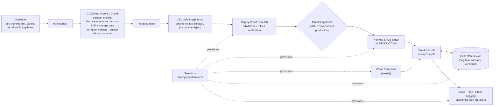

# Deployment & Operations

How the agent gets from a commit to running in production on Google Cloud,
and how it's operated once it's there.



## What's provisioned (`deployment/terraform`)

| File | Resources |
|---|---|
| `apis.tf` | Vertex AI, Cloud Run, Artifact Registry, Cloud Build, Scheduler, IAM/STS, Trace, Logging, Monitoring, **DLP** (PII de-identification), Storage |
| `iam.tf` | **Least-privilege** service accounts: `runtime` (Gemini, traces, logs, metrics, DLP), `cicd` deployer (Run developer, AR writer; can only act as `runtime`), `scheduler` (run invoker) |
| `wif.tf` | **Keyless CI/CD**: a Workload Identity Federation pool/provider restricted to this GitHub repository. No service-account keys exist anywhere. |
| `runtime.tf` | Artifact Registry (with cleanup policy), **versioned GCS state bucket** (public access prevented), **Cloud Run Job** (2 vCPU / 2 GiB, 3 h timeout, 1 retry), **Cloud Scheduler** weekly trigger |
| `monitoring.tf` | Alert policy and optional email channel when a research run fails |
| `outputs.tf` | Values to paste into GitHub repository variables |

Environments are separate Terraform states (`staging`, `prod`) using the same code. `prod` jobs have deletion protection.

## One-time setup

```bash
export PROJECT_ID=your-project
gcloud storage buckets create gs://$PROJECT_ID-tfstate --location=us-central1   # remote state
make tf-init ENV=staging && make tf-apply ENV=staging
make tf-init ENV=prod    && make tf-apply ENV=prod
terraform -chdir=deployment/terraform output
```

Add the outputs as **GitHub repository variables**, not secrets, because none of them are sensitive: `GCP_PROJECT_ID`, `GCP_REGION`, `GCP_WIF_PROVIDER` and `GCP_SERVICE_ACCOUNT`. Then create GitHub Environments named `staging` and `production`, with required reviewers on `production`.

Until those variables exist, the CD, infrastructure and refresh workflows **skip cleanly** rather than fail.

## Pipelines

| Pipeline | Where | Trigger | What it does |
|---|---|---|---|
| CI | `.github/workflows/ci.yml`, `.cloudbuild/pr_checks.yaml` | push / PR | ruff, bandit, pip-audit, gitleaks, pytest on 3.11 and 3.12 with an **80% coverage gate**, `terraform validate`, docker build + container smoke test |
| CD | `.github/workflows/cd.yml`, `.cloudbuild/staging.yaml` | push to `main` (code paths) | build once → push digest → deploy **staging** → verify → **approval** → promote the same digest to **prod** (`.cloudbuild/deploy-to-prod.yaml`) |
| Infrastructure | `.github/workflows/infra.yml` | PR touching Terraform / manual | `terraform plan`, or `apply` after approval |
| Report refresh | Cloud Scheduler → Cloud Run Job (prod); `.github/workflows/refresh-report.yml` (alternative) | weekly | runs a research cycle and persists memory; the GitHub variant opens a **PR for human approval** before publishing |
| Pages | `.github/workflows/pages.yml` | `research-data` updated | deploys `reports/` from the `research-data` branch to GitHub Pages |
| Dependencies | `.github/dependabot.yml` | weekly / monthly | pip, Actions, Docker and Terraform updates |

## Operating it

| Task | Command |
|---|---|
| Run the job now | `make run-job ENV=prod` |
| Roll out a hot-fix image manually | `make deploy-job ENV=staging` |
| Roll back | `gcloud run jobs update adoption-agent-prod --image <previous digest>`. Artifact Registry keeps the last 10. |
| Recover a failed run | Evidence is persisted even on failure; run with `--resume` |
| Restore memory | The GCS bucket is versioned; restore a prior `data/evidence.db` generation |
| Alternative hosting | `make deploy-agent-engine` deploys to Vertex AI Agent Engine |

## Security & privacy controls

- No credentials in the repo: keyless WIF, a gitleaks scan in CI and pre-commit, and `.env` gitignored.
- A non-root container (UID 10001), a multi-stage build and pinned dependencies (`requirements.lock`).
- **PII masking at every boundary** (see the README *Privacy* section), with Cloud DLP enabled in the cloud deployment (`pii_backend = "dlp"`). Each run writes a privacy audit to `runs/<id>/privacy.json`.
